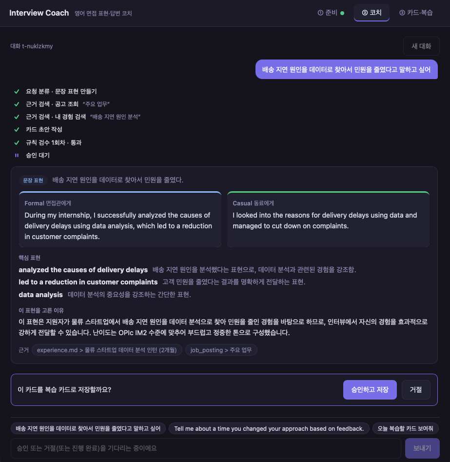
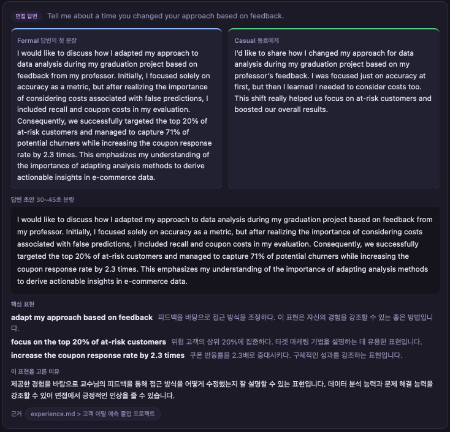
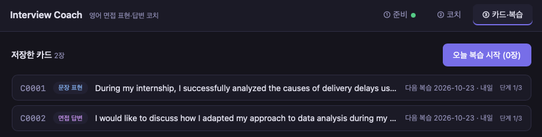

# Interview Coach Agent

내 경험 서류와 지원 공고를 근거로 **영어 면접 표현·답변 카드**를 만들고, 규칙 검수를 거친 뒤 **사용자가 웹에서 승인한 것만** 복습 카드로 저장하는 웹 서비스.
SKALA AI 미니프로젝트 — 10/13 CLI 에이전트("dapdap")를 FastAPI·SSE·Vue·MCP 기반 웹 서비스로 확장했다.

## 실행 화면 (E2E 시나리오)

| ① 문장 표현 → 승인·저장 | ② 면접 질문 답변 | ③ 복습 |
|---|---|---|
|  |  |  |

실행 기록(출력 포함): [`eval/demo.ipynb`](eval/demo.ipynb) · 화면별 캡처(MOCK): [`web/captures/`](web/captures/)

## 구조

```
브라우저(Vue 3, 탭 ①준비 ②코치 ③카드) → web_server.py(:8600, 정적 서빙 + SSE 무버퍼 프록시)
  → server.py(:8100, FastAPI, lifespan에서 Deps 1회 조립)
  → LangGraph Supervisor: router → Coach(ReAct 서브그래프) → Reviewer(LLM+규칙 서브그래프) ⟲최대 2회 재작성
                         → approve(interrupt, HITL) → save | rejected,   review_cards, out_of_scope
  → MCP 서버 "coach"(stdio): Tool search_my_experience(RAG)·search_expression_bank / Resource posting://{section} / Prompt persona_review_prompt
  → SQLite: checkpoints.db(승인 대기 상태), coach.db(승인된 카드·복습 단계)
```

## 기술 요소 ↔ 코드 위치

| 요소 | 구현 | 위치 |
|---|---|---|
| Multi-Agent | Coach / Reviewer 서브그래프 + Supervisor | `agent/coach_agent.py`, `agent/reviewer_agent.py`, `agent/graph.py` |
| MCP | Tool 2 · Resource 1 · Prompt 1, 래퍼 Tool로 연결 | `mcp_server.py`, `agent/mcp_client.py`, `agent/tools.py` |
| RAG | 제목 단위 분할 → 임베딩 → 코사인 검색, mtime 재색인 | `rag.py` |
| DI | `Deps`를 lifespan에서 1회 조립해 노드에 주입 | `contracts/deps.py`, `agent/deps.py`, `server.py` |
| HITL | `interrupt()` + `AsyncSqliteSaver`, 새로고침·재시작 후 복원 | `agent/graph.py`, `routers/chat.py` |
| 오류 처리 | 4계층·재시도 가능 여부·코드별 메시지, timeout만 백오프 재시도 | `contracts/errors.py`, `agent/tools.py` |
| LangSmith | 환경변수로 trace, 노드·MCP·LLM 계층 | `.env.example` |
| 모듈화·계약 | 역할 간 접점을 `contracts/`에 코드로 고정 | `contracts/` |
| 단위테스트 | fake 모델·fake MCP, 네트워크 없음 (179개, 계약 테스트 43개 포함) | `tests/`, `check.sh` |

## 실행 방법

```bash
bash sh/setup_venv.sh                 # .venv + requirements.txt
cp .env.example .env                  # 모델 설정 (ollama 기본값, OpenAI는 키 필요)
bash sh/seed_sample.sh                # 샘플 서류(examples/sample_user) → data/
.venv/bin/python server.py            # 터미널 1: API :8100
.venv/bin/python web_server.py        # 터미널 2: 화면 http://localhost:8600
MOCK=1 .venv/bin/python web_server.py # 백엔드 없이 화면만 (fixture 재생)
bash check.sh                         # ruff·테스트·계약·금지 패턴·소유권·ADR 점검
```

모델은 `.env`의 `FAST_MODEL`·`QUALITY_MODEL`·`EMBEDDING_MODEL` (`provider:model`, 테스트는 `fake`). ollama는 `qwen3.5:4b`를 권장한다(ADR-0019, 0020).

평가 재현: `uv pip install --python .venv/bin/python -r requirements-eval.txt` 후 `bash eval/run_all.sh` → `.venv/bin/python eval/measure_extras.py` → `.venv/bin/python eval/make_notebooks.py`.

## Before / After (같은 모델 gpt-4o-mini, sample 테스트셋 10건 × 3회)

| 지표 | v1 (10/13 CLI) | v2 (웹 서비스) |
|---|---|---|
| 카드 생성 성공 | 17/21 (81%) | **21/21 (100%)** |
| 라우팅 정확도 | 26/30 | **30/30** |
| 실패 | 시간 초과 3 · OpenAI 400 1 | 없음 |
| 개인 맥락 점수(LLM-judge, 5점) | 4.93 | 4.86 |
| 성공 카드 생성 지연 | 13.2초 | 15.3초 |
| 재시작 후 승인 대기 복원 | 0/3 (메모리) | **3/3** |
| 동시 2요청 | 순차만 | 28.4초 → **14.5초** |

상세·해석·한계: [`eval/before_after.ipynb`](eval/before_after.ipynb)

## 한계 (실측)
1. MCP stdio 오버헤드 호출당 약 1ms — 지연 증가의 주원인은 검색·재작성 증가(카드당 검색 1.7 → 4.2회)
2. 체크포인트 DB 대화당 약 121KB — 정리 정책 필요
3. 소형 로컬 모델의 구조화 출력: gpt-4o-mini 7/7, qwen3.5:4b 5/7, qwen3:8b 0/7
4. 단일 사용자(SQLite, 다중 인스턴스 불가) · 외부 LLM 사용 시 서류 전송

## 문서

| 문서 | 내용 |
|---|---|
| [doc/design.md](doc/design.md) | 설계 기준 (목표·구조·API·테스트·범위) |
| [doc/handoff/flow-guide.md](doc/handoff/flow-guide.md) | 흐름 설명서 (엔드포인트·데이터 위치·시나리오·용어) |
| [doc/adr/README.md](doc/adr/README.md) | 설계 결정 기록 22건 (기각한 대안 포함) |
| [doc/work-plan.md](doc/work-plan.md), [agent.md](agent.md) | 역할 분담·작업 규칙 |

개인정보: 저장소와 시연에는 가상의 `examples/sample_user`만 쓴다. 실제 서류가 들어가는 `data/`는 커밋하지 않는다.
